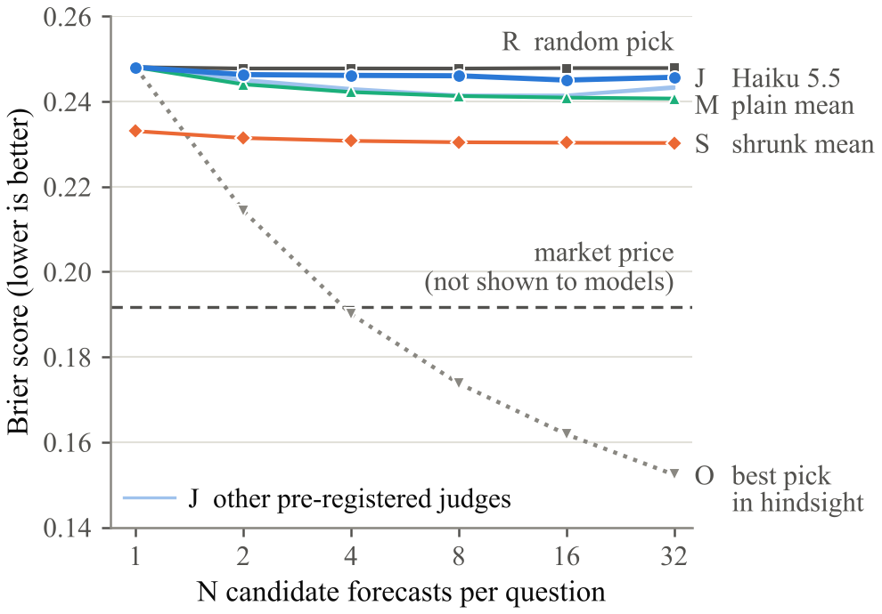

# Longer, Not Better

**Rubric LLM judges favor longer forecasts, not more accurate ones.**

Paper: [paper/main.pdf](paper/main.pdf) (4 pages, then references and an appendix; AAAI-27 two-column format).

## Question

LLM judges score reasoning before any answer key exists. Their scores pick the best of N outputs, filter training data and reward agents. We ask: given 32 forecasts of the same event by the same model, does an outcome-blind rubric judge prefer the more accurate ones?

## Setup

- 409 Kalshi questions that resolved in July–September 2026, after the stated training cutoffs of the forecasters and the primary judge.
- Forecasters: Claude Sonnet 5.5 and GPT-6 Luna, 32 forecasts per question each (26,176 in total).
- Judges: Claude Haiku 5.5 (primary), Gemma 4 31B and GLM-5 (pre-registered), Gemini 3.1 Flash-Lite and DeepSeek V4 Flash (exploratory), all with the Prophet Arena reasoning rubric. GPT-5.5 judged a pilot subset.
- Endpoints fixed before the run. Confidence intervals resample events.

## Results

Claude Sonnet 5.5 forecasts, N = 32, Brier score (lower is better):

| Option | Brier |
|---|---|
| Always answer 50% | 0.250 |
| Random pick | 0.248 |
| Judge's pick (Haiku 5.5) | 0.246 |
| Forecast nearest the mean of the 32 | 0.242 |
| Plain mean | 0.241 |
| Shrunk mean | 0.230 |
| Market price (no model saw it) | 0.192 |

- The judge's pick scores like a random pick. Two simple rules that read only the stated probabilities (take the forecast nearest the mean, or the least extreme one) do as well or better.
- Judge scores follow text length, not accuracy. Of two forecasts written from the same evidence, Haiku prefers the longer one 54.6% of the time and the more accurate one 50.3%.
- The stated number alone moves the score. With the text fixed, judges penalize extremizing the probability more than shrinking it, although only shrinking improves accuracy.



## Two audits that need no outcomes

1. **Same-evidence pairs.** Does the judge prefer the longer of two forecasts written from the same evidence?
2. **Number edits.** Change only the final probability. Does the score fall more when the number moves away from 50%?

A judge that fails these tests should not select forecasts.

## Build

```
cd paper
tectonic -X compile main.tex
```

`main.tex` starts with a two-line shim so that Tectonic (XeTeX) can load `aaai2027.sty`. For a submission build, delete the shim and compile with pdfLaTeX.
